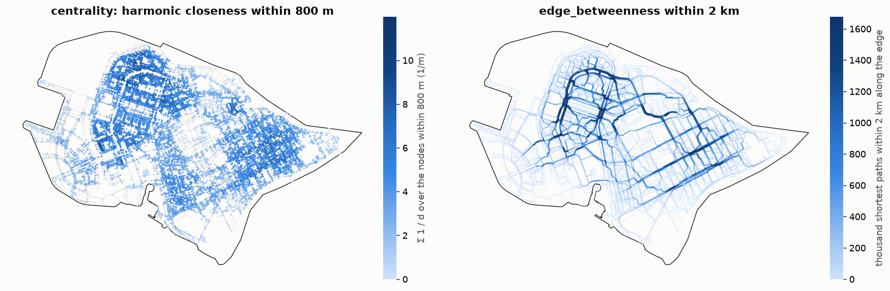

Centrality
==========

.. currentmodule:: iduedu

Overview
--------

Centralities rank the nodes and edges of a network by their position in it. :func:`centrality` measures how much
of the network lies within a threshold of every node (reach, harmonic closeness, gravity) and how many shortest
paths pass through it (betweenness). :func:`edge_betweenness` counts the shortest paths along every edge.

.. code-block:: python

   nodes = iduedu.centrality(walk, ["reach", "harmonic", "gravity"], cutoffs=[400, 800, 1600])
   flows = iduedu.edge_betweenness(walk, cutoffs=2000)
   walk.edges_gdf["betweenness"] = flows["betweenness_2000"]

Every measure is local: it looks only at the nodes within the threshold along the network, measured by
``length_meter`` (metres, the default) or ``time_min`` (minutes). ``cutoffs=None`` removes the threshold.

Method
------

Measures of a node
~~~~~~~~~~~~~~~~~~

For a node ``i`` let ``j`` run over the other nodes within the threshold, ``d`` be the cost of the shortest path
from ``i`` to ``j`` and ``w`` the weight of ``j`` (1 without ``node_weights``).

.. list-table::
   :header-rows: 1
   :widths: 18 32 50

   * - Measure
     - Value
     - Meaning
   * - ``reach``
     - ``Σ w``
     - How much is within the threshold: nodes, or residents with ``node_weights``
   * - ``harmonic``
     - ``Σ w / d``
     - Closeness that favours near nodes (Marchiori and Latora, 2000); nodes at cost 0 are left out
   * - ``gravity``
     - ``Σ w · exp(-beta · d)``
     - The same with an exponential decay (Hansen, 1959); ``beta`` is ``4 / threshold`` by default
   * - ``betweenness``
     - shortest paths through ``i``
     - How many shortest paths no longer than the threshold pass through the node (Freeman, 1977)

Reach, harmonic and gravity take one cut-off search from every reported node, and several thresholds come from
the same searches. ``direction="to"`` measures the paths towards the node on a directed graph.

Betweenness
~~~~~~~~~~~

Betweenness is computed with the algorithm of Brandes (2001): one search from every node of the graph, then a pass
back along the search tree that hands every node its share of the paths. A path between two nodes counts with the
weights of both of its ends. When several routes are equally short, the path is split between them equally. The
end points of a path are not counted, and on an undirected graph every pair of nodes counts once.

Every node has to run its own search, also when only the nodes inside ``area`` are reported, so betweenness takes
much longer than the other measures. ``sample`` runs the searches from a random part of the nodes and scales the
result up to all of them (Brandes and Pich, 2007); ``seed`` fixes the sample.

:func:`edge_betweenness` counts the same paths along the edges. An edge that can be travelled both ways carries the
paths of both directions. Among parallel edges between two nodes only the cheapest one carries paths, and equally
cheap ones share them.

Border effects
~~~~~~~~~~~~~~

A node near the border of a graph has part of its surroundings cut off, so its values are too low. Build the graph
with a margin at least as wide as the largest threshold and pass the study ``area``: only the nodes inside are
reported, and the searches still use the whole graph. ``area`` follows the rule of ``territory`` in the graph
builders (a bare shapely geometry is in EPSG:4326).

Outputs
-------

:func:`centrality` returns a table indexed by node id with one column per measure and threshold, named
``<measure>_<threshold>`` (``reach_400``, ``harmonic_800``, ``betweenness_inf``). :func:`edge_betweenness` returns a
table indexed like ``edges_gdf`` with one column ``betweenness_<threshold>`` per threshold.

On the walk graph of Vasilyevsky Island (22 289 nodes) on 16 threads, the three measures of a node within 400, 800
and 1 600 m take 0.65 s. Betweenness of the nodes within 2 000 m takes 1.2 s, and betweenness of the edges takes
1.2 s within 2 000 m, 3.6 s without a threshold and 0.17 s without a threshold from a sample of 1 000 nodes.

Functions
---------

.. autosummary::
    :toctree: ../api/generated
    :nosignatures:

    centrality
    edge_betweenness

Figures
-------

   The walk graph of Vasilyevsky Island measured by ``length_meter``. Left: ``harmonic_800`` of every node, high
   where short streets and walkways are dense. Right: ``betweenness_2000`` of every edge; the line width grows
   with the value up to its 99.5th percentile. The paths within 2 km concentrate on a few long straight walkways
   that link the parts of the island.

Limitations
-----------

- Values near the border of a graph are biased low, see Border effects above.
- On a walk graph a street with two sidewalks splits its paths between them, so betweenness of the sidewalks is
  lower than that of a street drawn as one line.
- Without a threshold, harmonic closeness and gravity sum over the whole graph, and betweenness needs a search
  of the whole graph from every node.

References
----------

- Brandes, U. (2001). A faster algorithm for betweenness centrality. *Journal of Mathematical Sociology*, 25(2),
  163–177.
- Brandes, U. and Pich, C. (2007). Centrality estimation in large networks. *International Journal of Bifurcation
  and Chaos*, 17(7), 2303–2318.
- Freeman, L. C. (1977). A set of measures of centrality based on betweenness. *Sociometry*, 40(1), 35–41.
- Hansen, W. G. (1959). How accessibility shapes land use. *Journal of the American Institute of Planners*, 25(2),
  73–76.
- Marchiori, M. and Latora, V. (2000). Harmony in the small-world. *Physica A*, 285(3–4), 539–546.

Example notebook
----------------

:doc:`../examples/network_analysis`
