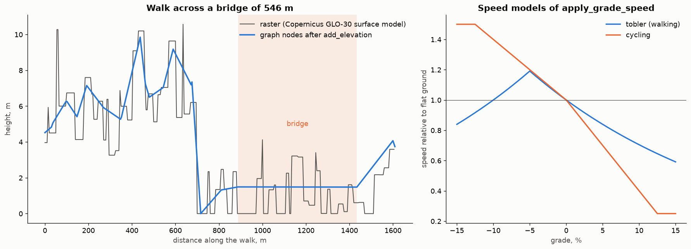

Elevation
=========

.. currentmodule:: iduedu

Overview
--------

:func:`add_elevation` gives every node a height and every edge its grade, its steepest grade and the metres it
climbs and descends. :func:`apply_grade_speed` then rescales travel times with a speed model that depends on the
grade, so that routes and accessibility account for hills. :func:`graph_stats` reports the heights and grades of a
graph that carries them.

.. code-block:: python

   walk = iduedu.add_elevation(walk, "dem.tif")          # raster in any CRS
   walk = iduedu.apply_grade_speed(walk, "tobler")       # walking times on slopes
   bike = iduedu.get_bike_graph(territory=area, elevation="dem.tif")   # cycling speed model built in

Reading rasters needs the optional dependency rasterio:

.. code-block:: bash

   pip install "iduedu[elevation]"

Inputs
------

``elevation`` is one of:

- a raster file, a digital elevation model in any CRS, read with rasterio; only the window that covers the graph
  is read, and heights are interpolated bilinearly;
- a GeoDataFrame of spot heights (points) or contour lines with heights in ``column``; contours are turned into
  points at their vertices and every ``sample_distance`` metres along them, and heights between the points are
  interpolated linearly on a triangulation (``method="linear"``, the nearest height outside it), taken from the
  nearest point (``"nearest"``) or weighted by the inverse squared distance to the eight nearest points
  (``"idw"``);
- a function ``f(x, y) -> z`` of coordinate arrays in the graph CRS.

The graph must be in a projected CRS with lengths in metres.

Method
------

Heights and grades
~~~~~~~~~~~~~~~~~~

Every node gets the height of the source at its point, in the column ``elevation`` (metres). Every edge is sampled
along its geometry at steps of at most ``sample_distance`` (20 m by default); the ends take the heights of their
nodes. In the direction from ``u`` to ``v`` the edge gets:

.. list-table::
   :header-rows: 1
   :widths: 22 78

   * - Column
     - Value
   * - ``grade``
     - Rise between the end nodes over the length, positive uphill (0.05 is 5 %)
   * - ``grade_max``
     - The steepest absolute grade between two neighbouring samples
   * - ``ascent``
     - Metres climbed along the edge
   * - ``descent``
     - Metres descended along the edge

An edge that runs over a hill has a ``grade`` close to 0 and a large ``ascent`` and ``descent``.

Bridges and tunnels
~~~~~~~~~~~~~~~~~~~

A bridge does not follow the river below it, and a tunnel does not follow the hill above it. Edges with a
``bridge`` or ``tunnel`` tag other than ``no`` (``structure_columns``) get a straight profile between their ends.
A node that touches only such edges stands inside the structure: its height is interpolated between the ends of the
structure, linearly along a chain of edges and as a mean weighted by inverse length at a junction. The ends of a
structure are the nodes where it meets an ordinary edge, and they keep the height of the ground. The drive, walk and
bike builders keep the ``bridge`` and ``tunnel`` tags and never merge a structure with the road it continues, so its
ends stay nodes of the graph.

Speed on slopes
~~~~~~~~~~~~~~~

:func:`apply_grade_speed` divides the time of every edge by the speed that the model gives for its grade, relative
to the speed on flat ground. An edge that goes up and down is taken as a climb of ``ascent`` followed by a drop of
``descent``, both at the mean absolute grade ``(ascent + descent) / length``. An edge that serves both directions
gets the mean of the two. The times before the change are kept in ``time_min_flat``, and a repeated call starts
from them, so models can be swapped without rebuilding the graph.

``"tobler"``
   Tobler's hiking function (Tobler, 1993), ``exp(-3.5 |g + 0.05|)``, divided by its value on flat ground. Walking
   is fastest on a descent of 5 %, at 1.19 times the flat speed, and takes 1.7 times longer on a climb of 15 %.

``"cycling"``
   A linear model: the speed falls by 6 % for every per cent of climb, down to 0.25 of the flat speed, and grows
   by 4 % for every per cent of descent, up to 1.5 of it. :func:`get_bike_graph` applies it when ``elevation`` is
   given.

A function that maps an array of signed grades to relative speeds can be passed as ``model``. ``edge_types``
restricts the change to edges of the given ``type``, for example ``["walk"]`` on an intermodal graph.

Outputs
-------

:func:`add_elevation` returns a new :class:`UrbanGraph` with ``elevation`` on the nodes and ``grade``, ``grade_max``,
``ascent`` and ``descent`` on the edges. Nodes outside the source get ``NaN``, and so do the edges that touch them.
:func:`apply_grade_speed` returns a new graph with changed ``time_min`` and the column ``time_min_flat``. After
:func:`add_elevation`, :func:`graph_stats` adds ``elevation_min``, ``elevation_max``, ``elevation_mean``,
``grade_mean`` (mean absolute grade weighted by length) and ``grade_max``. The walk graph of Saint Petersburg takes
3.1 s from a raster of 30 m.

Functions
---------

.. autosummary::
    :toctree: ../api/generated
    :nosignatures:

    add_elevation
    apply_grade_speed

Figures
-------

   Left: a walk of 1.6 km on Vasilyevsky Island across a bridge of 546 m, with heights from the Copernicus GLO-30
   raster of 30 m. The nodes follow the raster on the ground, and the bridge (shaded) gets a straight profile
   between its ends. GLO-30 is a surface model: in built-up blocks it measures roofs and trees, which gives the
   heights of 4 to 10 m on the first 700 m of the walk. Right: the speed relative to flat ground of the two models
   of :func:`apply_grade_speed`.

Limitations
-----------

- The heights are only as good as the source. Global models such as Copernicus GLO-30 and SRTM are surface models
  of 30 m cells; in cities they measure roofs and trees, and street grades computed from them are too steep. Use a
  terrain model (DTM) or survey heights for street grades.
- A structure without a ``bridge`` or ``tunnel`` tag follows the ground. A structure that touches no ordinary edge
  keeps the heights sampled at its nodes.
- The speed models describe an average walker or cyclist; they do not account for steps, surfaces or loads.

References
----------

- Tobler, W. (1993). *Three presentations on geographical analysis and modeling*. Technical Report 93-1, National
  Center for Geographic Information and Analysis, Santa Barbara.

Example notebook
----------------

:doc:`../examples/elevation`
