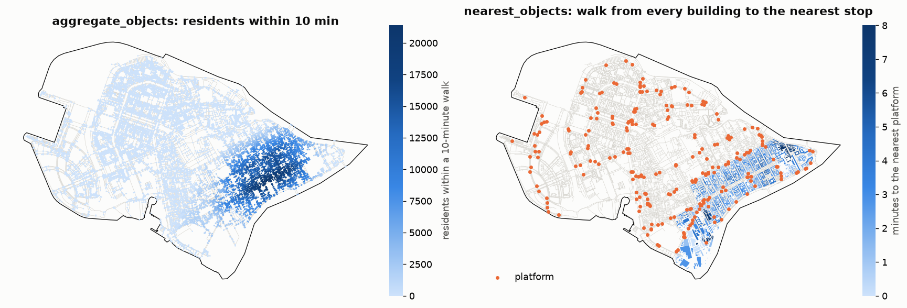

Objects around origins
======================

.. currentmodule:: iduedu

Overview
--------

These functions answer what lies near a place along the network: the nearest school of every home, the number of
residents within a 10-minute walk of every street corner, how mixed the shops around a station are.

.. list-table::
   :header-rows: 1
   :widths: 34 66

   * - Function
     - Result
   * - :func:`nearest_objects`
     - The ``k`` nearest objects of every origin and the travel cost to each
   * - :func:`aggregate_objects`
     - The count of objects and the sums and means of their values within one or several travel costs
   * - :func:`diversity`
     - The number of categories, the Shannon entropy and the Hill number of the objects within a travel cost

.. code-block:: python

   nearest = iduedu.nearest_objects(walk, gdf_origins=homes, gdf_objects=schools, k=3)
   residents = iduedu.aggregate_objects(walk, [5, 10, 15], gdf_origins=stops, gdf_objects=homes,
                                        columns=["resident_number"])
   mix = iduedu.diversity(walk, 10, "shop_type", gdf_objects=shops, gdf_origins=stations)

Inputs
------

Origins and objects are graph nodes. They are given as node ids (``origins_nodes``, ``object_nodes``) or as tables
(``gdf_origins``, ``gdf_objects``). A table with a ``graph_node_id`` column (the name is set by
``graph_node_column``) is used as is; otherwise every geometry is matched to its nearest graph node by its representative point,
a point inside the geometry. Travel costs are measured between those nodes. To measure from the entrance of a
building on the nearest street, insert the objects into the graph with :func:`project_objects2urban_graph` first
(see :doc:`../graph/operations`).

``weight`` is ``time_min`` (minutes, the default) or ``length_meter`` (metres), and ``cutoff`` is inclusive in the
same units. ``direction="from"`` measures the way from the origin to the object and ``direction="to"`` the way
back. The two differ on directed graphs, such as a drive graph with one-way streets or an intermodal graph with
boarding waits.

Method
------

Nearest objects
~~~~~~~~~~~~~~~

:func:`nearest_objects` runs one search from every origin node and stops it once ``k`` objects are settled or
``cutoff`` is passed. The time therefore depends on how far the objects are, not on how many there are. Several
objects on one node are returned in the order of the object table.

Sums within a travel cost
~~~~~~~~~~~~~~~~~~~~~~~~~

:func:`aggregate_objects` adds up the objects within ``cutoff`` of every origin. It searches from the smaller side.
With fewer origins than objects, one cut-off search from every origin collects the objects it settles. With fewer
objects, one search from every object runs on the reversed graph and hands the values of the object to every origin
it reaches. Both give the same numbers. Several cutoffs are computed from the same searches.

With ``decay`` every object counts with a weight that falls with its travel cost ``d``:

.. list-table::
   :header-rows: 1
   :widths: 20 30 50

   * - ``decay``
     - Weight
     - Note
   * - ``None``
     - 1
     - Every object in reach counts in full
   * - ``"linear"``
     - ``1 - d / cutoff``
     - 0 at the cutoff
   * - ``"exp"``
     - ``exp(-beta · d)``
     - ``beta`` is ``4 / cutoff`` by default, which leaves 0.018 at the cutoff
   * - ``"inverse"``
     - ``1 / d``
     - Objects at cost 0 are left out

Counts and sums are then weighted, and means are weighted means.

Diversity
~~~~~~~~~

:func:`diversity` takes the shares ``p`` of the categories of ``category`` among the objects in reach, from their
counts or from the sums of ``values`` (for example floor area), with the same decay. It returns the number of
categories, the Shannon entropy ``-Σ p ln p`` and the Hill number of order ``q`` (``hill_order``), the effective
number of equally common categories (Hill, 1973). Order 0 counts the categories, order 1 is the exponential of the
Shannon entropy, and order 2 (the default) is the inverse Simpson index ``1 / Σ p²``, which gives less weight to
rare categories.

Outputs
-------

.. list-table::
   :header-rows: 1
   :widths: 25 75

   * - Function
     - Table
   * - :func:`nearest_objects`
     - ``(origin, rank)`` MultiIndex (``rank`` from 1) with the columns ``object`` (the label of the object in its
       table, or its node id) and ``dist``; origins with fewer than ``k`` objects in reach have fewer rows
   * - :func:`aggregate_objects`
     - Indexed like the origins; for every cutoff ``c`` the columns ``count_c`` and, for each of ``columns``,
       ``<column>_sum_c`` and ``<column>_mean_c``
   * - :func:`diversity`
     - Indexed like the origins; for every cutoff ``c`` the columns ``richness_c``, ``shannon_c`` and ``hill_c``

On the walk graph of Vasilyevsky Island (22 289 nodes), the residents of 433 homes within 5, 10 and 15 minutes of
every node take 0.03 s on 16 threads, and the three nearest of 251 public-transport platforms for 1 258 buildings
take 0.01 s.

Functions
---------

.. autosummary::
    :toctree: ../api/generated
    :nosignatures:

    nearest_objects
    aggregate_objects
    diversity

Figures
-------

   Vasilyevsky Island with the buildings of the example data, which cover its south-eastern part (1 258
   buildings, 433 of them with 34 471 residents). Left: ``resident_number_sum_10`` of :func:`aggregate_objects`
   for every node of the walk graph. Right: :func:`nearest_objects` with ``k=1`` from every building to the
   platforms of the intermodal graph, by the walking edges of that graph; the median walk is 2.7 minutes, and
   93 % of the buildings are within 5 minutes.

Limitations
-----------

- Objects are represented by graph nodes. Without :func:`project_objects2urban_graph` the walk from an object to its
  nearest node is not counted.
- Near the border of the graph the objects beyond it are missing; build the graph and select the objects with a
  margin as wide as the largest cutoff.
- ``"inverse"`` decay leaves out objects on the origin node, whose weight would be infinite.

References
----------

- Hill, M. O. (1973). Diversity and evenness: a unifying notation and its consequences. *Ecology*, 54(2), 427–432.

Example notebook
----------------

:doc:`../examples/network_analysis`
