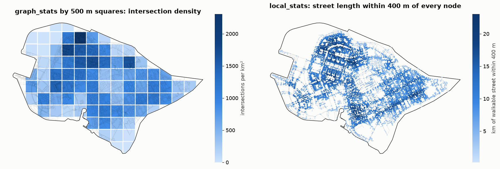

Network statistics
==================

.. currentmodule:: iduedu

Overview
--------

The statistics functions describe a graph that is already built: its size, density, junctions, shape and
connectivity, for the whole graph, inside a study area, for every zone of a grid or around every node.

.. list-table::
   :header-rows: 1
   :widths: 34 66

   * - Function
     - Result
   * - :func:`graph_stats`
     - Measures of the whole network, of the part inside ``area`` or of every one of ``zones``
   * - :func:`local_stats`
     - The same kind of measures around every node, within a network radius
   * - :func:`edge_stats`
     - Counts, lengths and speeds for every value of an edge column (``type``, ``highway``, ``category``)
   * - :func:`transport_stats`
     - Stops, routes, stop spacing and speed of every public-transport mode
   * - :func:`streets_per_node`
     - The number of streets that meet at every node
   * - :func:`route_directness`
     - Network distance over straight distance between origins and destinations

.. code-block:: python

   stats = iduedu.graph_stats(walk, area=district)              # one Series of measures
   by_square = iduedu.graph_stats(walk, zones=grid)             # one row per zone
   around = iduedu.local_stats(walk, [400, 800])                # one row per node
   iduedu.edge_stats(intermodal, by="type")                     # one row per edge type

Inputs
------

Every function reads an :class:`UrbanGraph` in a projected CRS with lengths in metres. ``area`` follows the rule of
``territory`` in the graph builders: a bare shapely geometry is in EPSG:4326 (longitude, latitude), and a
GeoSeries or GeoDataFrame carries its own CRS. ``zones`` is a GeoSeries or GeoDataFrame in any CRS. Both are
reprojected to the graph CRS. ``edge_types`` restricts the measures to the edges of the given ``type``, for
example ``["walk"]`` on an intermodal graph.

:func:`local_stats` measures its ``radius`` in metres by ``length_meter`` (the default) or in minutes with
``weight="time_min"``. Several radii are computed from the same searches.

Method
------

Streets
~~~~~~~

An OSM graph stores a two-way street as two directed edges, and a walk graph can store the same segment twice.
The statistics count a *street*: one undirected connection between two nodes, however many directed or parallel
edges the graph stores for it. Lengths are taken on the unique segments of the geometry
(:func:`unique_segments`), so the two directions of a street add their length once. A node with one street is a
dead end, and a node with three or more streets is an intersection.

The number of streets at a node always comes from the whole graph. With ``area`` or ``zones`` the nodes belong to
the zone they lie in, and streets and segments to the zone of their midpoint. A graph built with a margin around
the study area therefore gives the true number of streets at the nodes near the border. Nodes with one street
closer than ``boundary_buffer`` (1 m) to the boundary of ``area`` are streets cut by clipping and are not counted
as dead ends.

Measures of the network
~~~~~~~~~~~~~~~~~~~~~~~

:func:`graph_stats` returns the following groups of measures; a measure that is undefined for a graph or a zone
is ``NaN``.

.. list-table::
   :header-rows: 1
   :widths: 22 78

   * - Group
     - Measures
   * - Size
     - ``node_count``, ``edge_count`` (edges as stored), ``street_count``, ``street_length_total`` (metres),
       ``street_length_mean``
   * - Junctions
     - ``streets_per_node_mean``, ``dead_end_count``, ``dead_end_share``, ``intersection_count``,
       ``intersection_4way_share`` (four or more streets, among the intersections)
   * - Shape
     - ``circuity_mean`` (street length over the straight distance between its ends), ``self_loop_share``,
       ``parallel_street_share``, ``orientation_entropy`` and ``orientation_order``
   * - Connectivity
     - ``component_count``, ``largest_component_share``, ``beta_index``, ``gamma_index``, ``cyclomatic_number``,
       ``meshedness``
   * - Density
     - ``area_km2``, ``node_density``, ``intersection_density`` (per km²) and ``street_density`` (km per km²),
       with ``area`` or ``zones``
   * - Edge attributes
     - ``oneway_share`` (of street length), ``speed_mean_kmh``, elevation and grade after :func:`add_elevation`,
       platform and boarding counts on graphs with public transport

The connectivity indices compare the number of streets ``e`` with the number of nodes ``v`` and of components
``p``: the beta index is ``e / v``, the gamma index ``e / (3 (v - 2))``, the cyclomatic number ``e - v + p``
(independent cycles) and the meshedness ``(e - v + p) / (2 v - 5)``. The denominators are the largest numbers of
streets and cycles a planar graph can have. Only streets with both ends inside the area are counted for them.

The orientation measures sort the bearings of the segments into 36 bins of 10°, each segment weighted by its
length. ``orientation_entropy`` is the Shannon entropy of the bins in nats, and ``orientation_order`` rescales it
to 1 for a grid of two perpendicular directions and 0 for bearings spread evenly over all bins (Boeing, 2019).

Measures around every node
~~~~~~~~~~~~~~~~~~~~~~~~~~

:func:`local_stats` runs one cut-off search from every node and collects the nodes within ``radius``. Every street
gives half of its length to each of its two ends, so the street length around a node is the sum of the halves
held by the nodes in reach. For every radius ``r`` the result has the columns ``node_count_r``,
``intersection_count_r``, ``dead_end_count_r``, ``street_length_r`` (metres), ``streets_per_node_mean_r``,
``dead_end_share_r`` and ``intersections_per_km_r`` (intersections per kilometre of street). The node itself is
included.

Directness
~~~~~~~~~~

:func:`route_directness` divides the shortest network distance by the straight distance between the same two
nodes. A value of 1 is a straight route; the mean over a street grid is about 1.27. Without origins it takes
``sample`` random nodes (200 by default) as both origins and destinations. The result is a table with origins in
rows and destinations in columns, and ``result.stack().mean()`` is the mean directness.

Outputs
-------

On the walk graph of Vasilyevsky Island (22 289 nodes, 726 km of streets), ``graph_stats(walk)`` reports
14 244 intersections, 22 % of the nodes as dead ends, a mean circuity of 1.04 and an orientation order of 0.27.
A random sample of 200 nodes gives a mean directness of 1.25. On 16 threads the whole graph is measured in
0.06 s, 85 squares of 500 m in 0.14 s and every node within 400 and 800 m in 0.17 s.

Functions
---------

.. autosummary::
    :toctree: ../api/generated
    :nosignatures:

    graph_stats
    local_stats
    edge_stats
    transport_stats
    streets_per_node
    route_directness

Figures
-------

   The walk graph of Vasilyevsky Island. Left: ``intersection_density`` of :func:`graph_stats` with ``zones`` set
   to squares of 500 m (squares with less than half of their area on land are left out). Right:
   ``street_length_400`` of :func:`local_stats`, the length of walkable street within 400 m of every node along
   the network.

Limitations
-----------

- Junctions drawn as several nodes, such as dual carriageways and the crossings of a walk graph, inflate node and
  intersection counts. Merge them with :func:`consolidate_intersections` before comparing graphs from different
  sources.
- Densities depend on the zone boundaries; small zones and zones cut by water give unstable values.
- :func:`local_stats` near the border of a graph counts only the network inside it. Build the graph with a margin at
  least as wide as the largest radius.
- :func:`route_directness` represents objects by their nearest nodes, so the straight distance is measured between
  nodes, not between the objects.

References
----------

- Boeing, G. (2019). Urban spatial order: street network orientation, configuration, and entropy. *Applied Network
  Science*, 4, 67.

Example notebook
----------------

:doc:`../examples/network_analysis`
