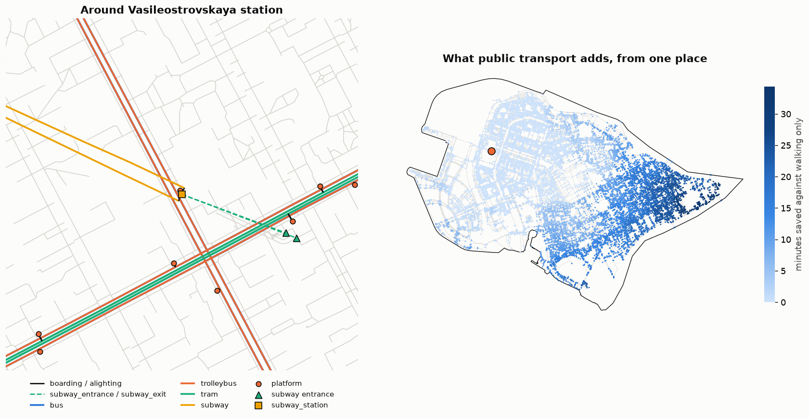

Intermodal graphs
=================

.. currentmodule:: iduedu

Overview
--------

An intermodal graph lets a route walk to a stop, wait, ride, change and walk on to the destination. It joins a walk
graph and a public-transport graph at the platforms: every platform is attached to the nearest walkable street, so
the shortest path decides by itself where walking ends and riding begins.

.. list-table::
   :header-rows: 1
   :widths: 30 70

   * - Function
     - Result
   * - :func:`get_intermodal_graph`
     - Builds the walk graph and the OSM public-transport graph of a territory and joins them
   * - :func:`join_pt_walk_graph`
     - Joins graphs that already exist, for example a GTFS graph (:doc:`gtfs`) and a walk graph

.. code-block:: python

   intermodal = iduedu.get_intermodal_graph(osm_id=1114252, pt_kwargs={"transport_types": ["bus", "tram", "subway"]})

   walk = iduedu.get_walk_graph(osm_id=1114252)
   gtfs = iduedu.get_gtfs_public_transport_graph("feed.zip", crs=walk.crs)
   intermodal = iduedu.join_pt_walk_graph(gtfs, walk, max_dist=30)

Inputs
------

``osm_id`` or ``territory``, ``clip_by_territory``, ``osm_edge_tags``
   Passed on to both builders (see :doc:`sources` and :doc:`streets`).

``walk_kwargs`` and ``pt_kwargs``
   Further arguments of :func:`get_walk_graph` (``walk_speed``, ``simplify``) and of
   :func:`get_public_transport_graph` (``transport_types``, ``transport_registry``). They override the shared
   arguments.

``max_dist``
   The largest distance, in metres, from a platform to the walk graph: 30 m in :func:`get_intermodal_graph` and
   20 m in :func:`join_pt_walk_graph`. Platforms farther away stay unconnected and are reported in the log.

``add_link_edge``
   ``True`` (the default) adds a walking edge from the platform to the street; ``False`` places the platform on
   the street itself.

``keep_largest_subgraph``
   Keep the largest connected component of the joined graph. Public-transport nodes dropped with smaller
   components are logged by type, because they mean that a mode lost its connection to the streets.

Both graphs must be in the same CRS. :func:`get_intermodal_graph` builds them for the same territory, so they are;
for :func:`join_pt_walk_graph` pass the CRS of the walk graph to the second builder.

Method
------

1. The two graphs are built; :func:`get_intermodal_graph` runs both builders in parallel.
2. The walk graph is made directed, with every walking edge in both directions, because public-transport edges
   have a direction.
3. Every platform-like node of the public-transport graph (``platform``, ``subway_entry_exit``,
   ``station_entry_exit``) is projected onto the nearest walking edge within ``max_dist`` with
   :func:`project_objects2urban_graph`. The edge is split at the projection point, and with ``add_link_edge`` a
   link edge at walking speed joins the platform to that point.
4. Projected platforms take the ids of their walk nodes and keep their attributes; the other public-transport
   nodes get new ids after those of the walk graph. Public-transport edges are renumbered to match, and the two
   edge tables are joined.
5. With ``keep_largest_subgraph`` the largest connected component is kept.

Waiting is part of the graph: a ``boarding`` edge from a platform to a route carries the wait of that route, so a
change between routes costs a walk between platforms, where needed, and a new wait (:doc:`public_transport`).

Outputs
-------

A directed :class:`UrbanGraph` of type ``intermodal`` whose edges have ``type`` ``walk`` or a public-transport type,
and ``oneway``. Every walking edge is stored once per direction. Routing functions work on it like on any other
graph, by ``time_min`` for travel times. For Vasilyevsky Island the joined graph has 23 665 nodes and 32 329 edges,
with all 251 platforms attached to the streets.

Functions
---------

.. autosummary::
    :toctree: ../api/generated
    :nosignatures:

    get_intermodal_graph
    join_pt_walk_graph

Figures
-------

   Left: the joined graph around Vasileostrovskaya subway station. Platforms (orange) sit at the streets, short black
   edges lead to the route stops of the lines, and the dashed edges lead from the entrances down to the station.
   Right: from one place in the west of the island, the minutes a route with public transport saves against walking
   only, for every node of the walk graph; in the east it exceeds 30 minutes.

Limitations
-----------

- Boarding waits are averages; the graph does not know when the next departure leaves.
- A platform farther than ``max_dist`` from any walkable street stays unconnected and, with
  ``keep_largest_subgraph``, is dropped with its routes when nothing else connects them.
- Changes between routes at one platform are free apart from the wait; walks inside large interchanges follow the
  mapped stop areas and pathways only.

Example notebook
----------------

:doc:`../examples/get_any_graph`
