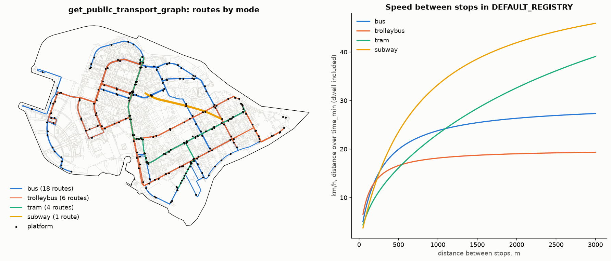

Public transport from OpenStreetMap
===================================

.. currentmodule:: iduedu

Overview
--------

:func:`get_public_transport_graph` builds the bus, trolleybus, tram, subway, monorail and share-taxi routes of a
territory from the route relations of OpenStreetMap. Travel times between stops come from a speed model of every
mode, and waiting times at boarding from the averages of the transport registry. For timetable travel and waiting
times use a GTFS feed (:doc:`gtfs`); to walk to and between stops, join the graph with a walk graph
(:doc:`intermodal`).

.. code-block:: python

   pt = iduedu.get_public_transport_graph(osm_id=1114252, transport_types=["bus", "tram", "subway"])

Inputs
------

``osm_id`` or ``territory``
   The territory, see :doc:`sources`. Every route relation that touches it is read with all its stops, also
   those outside; ``clip_by_territory=True`` cuts the graph at the boundary.

``transport_types``
   The modes to build: one name, a list, or ``None`` for every mode of the registry. A requested mode must exist in
   the registry, otherwise the builder raises ``ValueError``. OpenStreetMap tags some services under names the
   registry does not use: ``tram`` also reads ``route=light_rail`` relations and ``taxi`` reads
   ``route=share_taxi`` (``OSM_ROUTE_ALIASES`` in ``iduedu.constants.transport_specs``).

``transport_registry``
   The speed and waiting-time parameters of every mode, ``DEFAULT_REGISTRY`` by default. Trains need a registry that
   defines them, such as ``DEFAULT_REGISTRY_W_TRAIN``. See `Transport registry`_.

Method
------

Graph structure
~~~~~~~~~~~~~~~

Every route gets its own chain of *route stops*, one node per stop of the route, connected by travel edges whose
``type`` is the mode (``bus``, ``tram``, ...) and whose ``route`` is the route number. Routes that stop at the same
place share a *platform* node, the place where passengers wait. A ``boarding`` edge leads from the platform to the
route stop and carries the waiting time of the mode; an ``alighting`` edge leads back at no cost. A transfer between
routes therefore passes through a platform and pays the wait of the route boarded.

The subway is built from the stop areas of its stations. Station entrances (``subway_entry_exit`` nodes) are linked
to the station by ``subway_entrance`` and ``subway_exit`` edges. Their length is the slanted distance from the
entrance down to the station, the straight distance combined with the ``depth`` tag of the station, and their time
is that length at 0.75 m/s, the speed of an escalator. Stations of one interchange are linked by
``subway_transfer`` edges of 1.5 times their straight distance at 5 km/h. When a station lacks mapped entrances or
exits, its node becomes a ``platform`` and is joined to the walk graph directly.

Travel time between stops
~~~~~~~~~~~~~~~~~~~~~~~~~

For a segment of length ``L`` between two stops, the cruising speed ``v`` is the free speed of the mode
(``base_speed_kmh``, or ``v(L)`` below when ``long_speed_kmh`` is set), capped by ``vmax_tech_kmh`` and by the road
speed limit where that is lower. With ``span = accel_dist_m + brake_dist_m``:

- if ``L >= span``, the time is ``dwell_min + (L + span) / v``: accelerating and braking cost as much as covering
  ``span`` twice at cruising speed;
- if ``L < span``, the vehicle never reaches ``v``. Its peak speed is ``v * sqrt(L / span)`` and the time is
  ``dwell_min + 2 * L / v_peak``. Both cases give the same time at ``L == span``.

When ``long_speed_kmh`` and ``speed_half_length_m`` are set, the free speed grows with the segment length from
``base_speed_kmh`` towards ``long_speed_kmh``:

.. code-block:: text

   v(L) = base_speed_kmh + (long_speed_kmh - base_speed_kmh) * L / (L + speed_half_length_m)

It is halfway at ``L = speed_half_length_m``. Timetables of every mode show this growth: a long stretch between
stops runs on roads and tracks built for speed. A posted road limit does not raise the free speed; it is honoured
only where it is lower, so a motorway does not make a bus faster. Fitting the free speed as ``base + coef * limit``
against published timetables showed that the two terms cannot be told apart, and leaving the limit term out
improved the accuracy for every mode measured.

Transport registry
~~~~~~~~~~~~~~~~~~

A :class:`TransportRegistry` holds one :class:`TransportSpec` per mode:

.. list-table::
   :header-rows: 1
   :widths: 28 72

   * - Parameter
     - Meaning
   * - ``name``
     - Mode identifier, usually the OSM ``route=*`` value
   * - ``vmax_tech_kmh``
     - Technical maximum speed, km/h
   * - ``accel_dist_m``, ``brake_dist_m``
     - Distances to accelerate to and brake from the cruising speed, metres
   * - ``base_speed_kmh``
     - Free speed between stops, km/h
   * - ``long_speed_kmh``, ``speed_half_length_m``
     - Optional, set together: the free speed on long segments and the length at which half of the growth is
       reached
   * - ``dwell_min``
     - Time standing at a stop, added once per segment, minutes
   * - ``avg_wait_time_min``
     - Waiting time of the ``boarding`` edges, minutes

``DEFAULT_REGISTRY`` covers buses, trolleybuses, trams, subways, monorails and share taxis (``taxi``);
``DEFAULT_REGISTRY_W_TRAIN`` adds trains.

.. list-table::
   :header-rows: 1

   * - Mode
     - ``base_speed_kmh``
     - ``long_speed_kmh`` / ``speed_half_length_m``
     - ``avg_wait_time_min``
     - ``dwell_min``
   * - ``bus``
     - 29.5
     - none
     - 12.24
     - 0.387
   * - ``trolleybus``
     - 20.0
     - none
     - 8.02
     - 0.159
   * - ``tram``
     - 11.5
     - 74.1 / 3506
     - 5.22
     - 0.0
   * - ``subway``
     - 56.7
     - none
     - 3.26
     - 0.694
   * - ``monorail``
     - 56.7
     - none
     - 3.26
     - 0.694
   * - ``taxi``
     - 29.5
     - none
     - 12.24
     - 0.387
   * - ``train`` (``DEFAULT_REGISTRY_W_TRAIN`` only)
     - 33.5
     - 78.9 / 5270
     - 21.5
     - 0.365

Speeds and dwell times are fitted on every published GTFS segment that has its own geometry (``shapes.txt``), about
859 000 segments in 239 cities, minimising the error in scheduled minutes with every city weighing the same, and
cross-validated on held-out cities. A free speed that grows with the segment length is used for trams and trains,
where it carries over to unseen cities; buses, subways and trolleybuses keep one free speed, because the growing
form does not improve them. Waiting times are medians across cities of the average-day timetable wait over regular
services (06:00 to 22:00, a line counted towards the same next stop). Too few cities publish a timetable for
monorails or share taxis, so these two borrow the subway and bus profiles.

A custom registry changes the speeds or the waits of the modes:

.. code-block:: python

   from iduedu import DEFAULT_REGISTRY, TransportRegistry, TransportSpec, get_public_transport_graph

   registry = TransportRegistry({mode: DEFAULT_REGISTRY.get(mode) for mode in DEFAULT_REGISTRY.list_types()})
   registry.update("bus", base_speed_kmh=32.0, avg_wait_time_min=5.0)
   registry.update("tram", long_speed_kmh=60.0, speed_half_length_m=3000.0)
   registry.add(TransportSpec(name="ferry", vmax_tech_kmh=40, accel_dist_m=300, brake_dist_m=300,
                              base_speed_kmh=20.0, avg_wait_time_min=15.0))

   pt = get_public_transport_graph(osm_id=1114252, transport_registry=registry)

Mode names are normalised (lower case, stripped). ``registry.update("bus", name="express_bus")`` renames a mode,
and ``registry.ensure("ferry")`` creates a mode with default parameters when it is missing.
:func:`get_intermodal_graph` passes the registry on through ``pt_kwargs``.

Outputs
-------

A directed :class:`UrbanGraph` of type ``public_transport``. Nodes have ``type`` (``platform``, the mode of a route
stop, ``subway_station``, ``subway_platform``, ``subway_entry_exit``), ``route`` and ``name``; subway stations also
``depth``. Edges have ``type`` (the mode, ``boarding``, ``alighting``, ``subway_entrance``, ``subway_exit``,
``subway_station``, ``subway_transfer``), ``route``, ``length_meter``, ``time_min`` and ``oneway``. Boarding and
alighting edges have ``length_meter = 0``. :func:`transport_stats` summarises stops, routes and stop spacing by
mode.

Functions
---------

.. autosummary::
    :toctree: ../api/generated
    :nosignatures:

    get_public_transport_graph
    TransportSpec
    TransportRegistry

Figures
-------

   Left: the routes of Vasilyevsky Island by mode with their platforms. Right: the mean speed between two stops,
   the distance over ``time_min`` with the dwell time included, for the modes of ``DEFAULT_REGISTRY``. Short
   segments are slow for every mode because of acceleration, braking and dwell; trams and the subway gain most on
   long segments.

Limitations
-----------

- Travel and waiting times are averages of the mode, not of the route or the time of day. Use a GTFS feed for the
  timetable of a city (:doc:`gtfs`).
- Routes are only as complete as their relations in OpenStreetMap: a route without stops or with gaps in its ways
  gives a shorter or broken chain.
- The subway model needs mapped stop areas; entrances without a ``depth`` tag on the station are taken at ground
  level.

Example notebook
----------------

:doc:`../examples/transport_registry`
