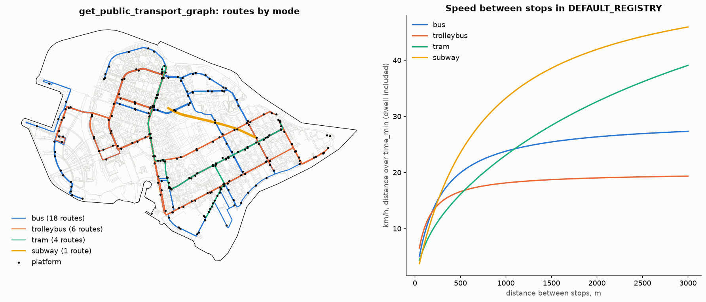

Public transport from OpenStreetMap
===================================

.. currentmodule:: iduedu

Overview
--------

:func:`get_public_transport_graph` builds the bus, trolleybus, tram, subway, monorail and share-taxi routes of a
territory from the route relations of OpenStreetMap. Travel times between stops come from a speed model of every
mode, and waiting times at boarding from the averages of the transport registry. For timetable travel and waiting
times use a GTFS feed (:doc:`gtfs`); to walk to and between stops, join the graph with a walk graph
(:doc:`intermodal`).

.. code-block:: python

   pt = iduedu.get_public_transport_graph(osm_id=1114252, transport_types=["bus", "tram", "subway"])

Inputs
------

``osm_id`` or ``territory``
   The territory, see :doc:`sources`. Every route relation that touches it is read with all its stops, also
   those outside; ``clip_by_territory=True`` cuts the graph at the boundary, and the routes table then keeps only
   the routes with an edge inside.

``transport_types``
   The modes to build: one name, a list, or ``None`` for every mode of the registry. A requested mode must exist in
   the registry, otherwise the builder raises ``ValueError``. OpenStreetMap tags some services under names the
   registry does not use: ``tram`` also reads ``route=light_rail`` relations and ``taxi`` reads
   ``route=share_taxi`` (``OSM_ROUTE_ALIASES`` in ``iduedu.constants.transport_specs``).

``transport_registry``
   The speed and waiting-time parameters of every mode, ``DEFAULT_REGISTRY`` by default. Trains need a registry that
   defines them, such as ``DEFAULT_REGISTRY_W_TRAIN``. See `Transport registry`_.

Method
------

Graph structure
~~~~~~~~~~~~~~~

Every route gets its own chain of *route stops*, one node per stop of the route, connected by travel edges whose
``type`` is the mode (``bus``, ``tram``, ...), whose ``route`` is the route number and whose ``route_key`` names
the route (see `Routes`_). Routes that stop at the same place share a *platform* node, the place where passengers
wait: platforms in one cell of a metre grid (coordinates rounded to whole metres) are one node at the first of them,
and so are the stops of one route in one cell. Every edge is drawn to the nodes it joins, and an edge between stops
merged into one node is left out. A ``boarding`` edge leads from the platform to the
route stop and carries the waiting time of the mode; an ``alighting`` edge leads back at no cost. A transfer between
routes therefore passes through a platform and pays the wait of the route boarded.

Route paths
~~~~~~~~~~~

Every route, the subway included, is drawn from its relation by one kernel of the Rust core, all routes at once.
The member ways are joined in the order the relation lists them. Pieces that share no vertex are ordered and turned
so that the straight joins between them are as short as possible in total, and a join longer than 1 km is not
drawn: the route is cut there into parts. Each platform is paired with one of its two nearest stops within 100 m,
the closest pairs first. A stop left without a platform gets one 7 m beside the path (a subway stop takes the
platform its stop area links it to, when there is one), and a platform without a stop serves as its own stop.
Stops are projected onto the path and ordered along it; a part is turned round when at least three stops within
100 m of it clearly list the opposite direction. Travel edges follow the path between consecutive stops, and their
speed limit is the length-weighted speed of the ways under them. A route whose path cannot be drawn is left out
with a warning, and so is a route with a single stop in the data, a fragment of a route mostly outside it: boarding
there leads nowhere.

The subway is built from the stop areas of its stations. Station entrances (``subway_entry_exit`` nodes) are linked
to the station by ``subway_entrance`` and ``subway_exit`` edges. Their length is the slanted distance from the
entrance down to the station, the straight distance combined with the ``depth`` tag of the station, and their time
is that length at 0.75 m/s, the speed of an escalator. Stations of one interchange are linked by
``subway_transfer`` edges of 1.5 times their straight distance at 5 km/h. When a station lacks mapped entrances or
exits, its node becomes a ``platform`` and is joined to the walk graph directly.

Routes
~~~~~~

A route here is one *variant* of a line: one ``type=route`` relation of OpenStreetMap, such as bus 3 towards the
station. Its key is ``osm:r<relation id>``, stable between builds while the relation exists. The route stops,
travel edges and boarding and alighting edges of a route carry its ``route_key``, and a platform lists the keys of
every route calling there. The key, not the number, decides which stops belong together: bus 3 there and back, or
bus 3 and tram 3, have chains of their own even where they stop at the same points.

The graph keeps a table of its routes, ``graph.routes``, one row per route and indexed by ``route_key``: the
``mode``, the tags of the relation (``ref``, ``name``, ``from``, ``to``, ``network``, ``operator``, ``colour``,
``interval``; set others with ``config.set_transport_route_attr``), ``osm_id``, the raw ``osm_route`` value, and
the line, the ``route_master`` relation that lists the route, as ``line_key`` (``osm:r<master id>``) and
``line_name``. The table holds attributes only: the geometry, the stops in their order, the length and the travel
time of a route come from its edges, with :func:`route_edges` and :func:`route_stops`. :func:`routes_in_area`
finds the routes with an edge or a stop in an area.

Travel time between stops
~~~~~~~~~~~~~~~~~~~~~~~~~

For a segment of length ``L`` between two stops, the cruising speed ``v`` is the free speed of the mode
(``base_speed_kmh``, or ``v(L)`` below when ``long_speed_kmh`` is set), capped by ``vmax_tech_kmh`` and by the road
speed limit where that is lower. With ``span = accel_dist_m + brake_dist_m``:

- if ``L >= span``, the time is ``dwell_min + (L + span) / v``: accelerating and braking cost as much as covering
  ``span`` twice at cruising speed;
- if ``L < span``, the vehicle never reaches ``v``. Its peak speed is ``v * sqrt(L / span)`` and the time is
  ``dwell_min + 2 * L / v_peak``. Both cases give the same time at ``L == span``.

When ``long_speed_kmh`` and ``speed_half_length_m`` are set, the free speed grows with the segment length from
``base_speed_kmh`` towards ``long_speed_kmh``:

.. code-block:: text

   v(L) = base_speed_kmh + (long_speed_kmh - base_speed_kmh) * L / (L + speed_half_length_m)

It is halfway at ``L = speed_half_length_m``. Timetables of every mode show this growth: a long stretch between
stops runs on roads and tracks built for speed. A posted road limit does not raise the free speed; it is honoured
only where it is lower, so a motorway does not make a bus faster. Fitting the free speed as ``base + coef * limit``
against published timetables showed that the two terms cannot be told apart, and leaving the limit term out
improved the accuracy for every mode measured.

Transport registry
~~~~~~~~~~~~~~~~~~

A :class:`TransportRegistry` holds one :class:`TransportSpec` per mode:

.. list-table::
   :header-rows: 1
   :widths: 28 72

   * - Parameter
     - Meaning
   * - ``name``
     - Mode identifier, usually the OSM ``route=*`` value
   * - ``vmax_tech_kmh``
     - Technical maximum speed, km/h
   * - ``accel_dist_m``, ``brake_dist_m``
     - Distances to accelerate to and brake from the cruising speed, metres
   * - ``base_speed_kmh``
     - Free speed between stops, km/h
   * - ``long_speed_kmh``, ``speed_half_length_m``
     - Optional, set together: the free speed on long segments and the length at which half of the growth is
       reached
   * - ``dwell_min``
     - Time standing at a stop, added once per segment, minutes
   * - ``avg_wait_time_min``
     - Waiting time of the ``boarding`` edges, minutes

``DEFAULT_REGISTRY`` covers buses, trolleybuses, trams, subways, monorails and share taxis (``taxi``);
``DEFAULT_REGISTRY_W_TRAIN`` adds trains.

.. list-table::
   :header-rows: 1

   * - Mode
     - ``base_speed_kmh``
     - ``long_speed_kmh`` / ``speed_half_length_m``
     - ``avg_wait_time_min``
     - ``dwell_min``
   * - ``bus``
     - 29.5
     - none
     - 12.24
     - 0.387
   * - ``trolleybus``
     - 20.0
     - none
     - 8.02
     - 0.159
   * - ``tram``
     - 11.5
     - 74.1 / 3506
     - 5.22
     - 0.0
   * - ``subway``
     - 56.7
     - none
     - 3.26
     - 0.694
   * - ``monorail``
     - 56.7
     - none
     - 3.26
     - 0.694
   * - ``taxi``
     - 29.5
     - none
     - 12.24
     - 0.387
   * - ``train`` (``DEFAULT_REGISTRY_W_TRAIN`` only)
     - 33.5
     - 78.9 / 5270
     - 21.5
     - 0.365

Speeds and dwell times are fitted on every published GTFS segment that has its own geometry (``shapes.txt``), about
859 000 segments in 239 cities, minimising the error in scheduled minutes with every city weighing the same, and
cross-validated on held-out cities. A free speed that grows with the segment length is used for trams and trains,
where it carries over to unseen cities; buses, subways and trolleybuses keep one free speed, because the growing
form does not improve them. Waiting times are medians across cities of the average-day timetable wait over regular
services (06:00 to 22:00, a line counted towards the same next stop). Too few cities publish a timetable for
monorails or share taxis, so these two borrow the subway and bus profiles.

A custom registry changes the speeds or the waits of the modes:

.. code-block:: python

   from iduedu import DEFAULT_REGISTRY, TransportRegistry, TransportSpec, get_public_transport_graph

   registry = TransportRegistry({mode: DEFAULT_REGISTRY.get(mode) for mode in DEFAULT_REGISTRY.list_types()})
   registry.update("bus", base_speed_kmh=32.0, avg_wait_time_min=5.0)
   registry.update("tram", long_speed_kmh=60.0, speed_half_length_m=3000.0)
   registry.add(TransportSpec(name="ferry", vmax_tech_kmh=40, accel_dist_m=300, brake_dist_m=300,
                              base_speed_kmh=20.0, avg_wait_time_min=15.0))

   pt = get_public_transport_graph(osm_id=1114252, transport_registry=registry)

Mode names are normalised (lower case, stripped). ``registry.update("bus", name="express_bus")`` renames a mode,
and ``registry.ensure("ferry")`` creates a mode with default parameters when it is missing.
:func:`get_intermodal_graph` passes the registry on through ``pt_kwargs``.

Outputs
-------

A directed :class:`UrbanGraph` of type ``public_transport``. Nodes have ``type`` (``platform``, the mode of a route
stop, ``subway_station``, ``subway_platform``, ``subway_entry_exit``), ``route``, ``route_key`` (the key of the
route of a route stop, the list of keys of the routes at a platform) and ``name``; subway stations also
``depth``. Edges have ``type`` (the mode, ``boarding``, ``alighting``, ``subway_entrance``, ``subway_exit``,
``subway_station``, ``subway_transfer``), ``route``, ``route_key`` (missing on the edges of stations),
``length_meter``, ``time_min`` and ``oneway``. Boarding and alighting edges have ``length_meter = 0``.
``graph.routes`` is the table of its routes (see `Routes`_). :func:`transport_stats` summarises stops, routes and
stop spacing by mode.

Functions
---------

.. autosummary::
    :toctree: ../api/generated
    :nosignatures:

    get_public_transport_graph
    route_edges
    route_stops
    routes_in_area
    TransportSpec
    TransportRegistry

Figures
-------

   Left: the routes of Vasilyevsky Island by mode with their platforms. Right: the mean speed between two stops,
   the distance over ``time_min`` with the dwell time included, for the modes of ``DEFAULT_REGISTRY``. Short
   segments are slow for every mode because of acceleration, braking and dwell; trams and the subway gain most on
   long segments.

Limitations
-----------

- Travel and waiting times are averages of the mode, not of the route or the time of day. Use a GTFS feed for the
  timetable of a city (:doc:`gtfs`).
- Routes are only as complete as their relations in OpenStreetMap: a route without stops or with gaps in its ways
  gives a shorter or broken chain.
- The subway model needs mapped stop areas; entrances without a ``depth`` tag on the station are taken at ground
  level.
- The graph has one projected CRS, the UTM zone of the centre of the territory. Over a country it stretches lengths
  far from that zone; build such areas in parts. The routes alone of a large area, without its streets, are cut out
  of a regional extract with ``split_by_polygons(..., way_keys=())`` or ``download_osm_pbf(..., way_keys=())``.

Example notebook
----------------

:doc:`../examples/transport_registry`
