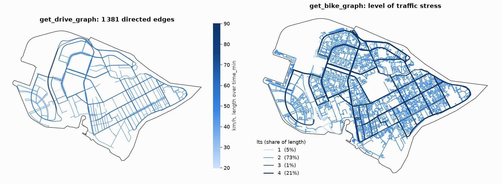
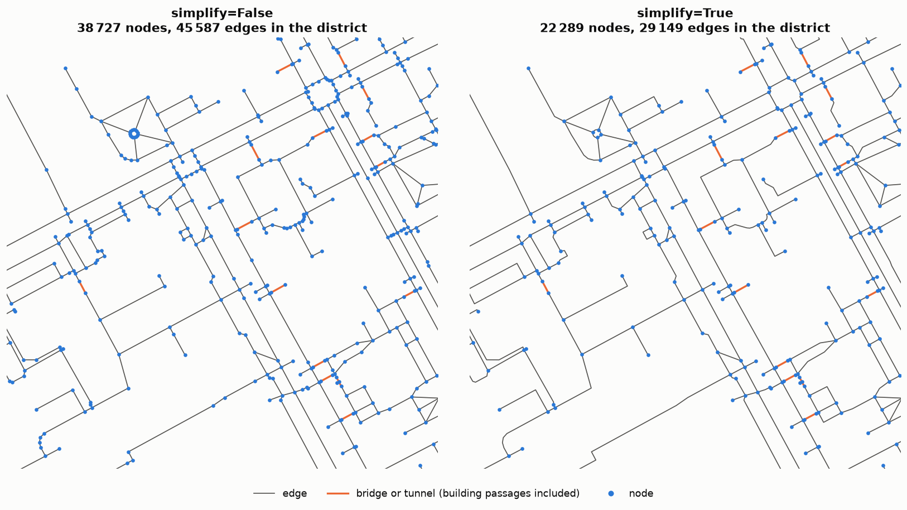

Streets: drive, walk and bike
=============================

.. currentmodule:: iduedu

Overview
--------

Three builders turn the OpenStreetMap ways of a territory into street networks.

.. list-table::
   :header-rows: 1
   :widths: 24 16 60

   * - Builder
     - Graph
     - Travel time ``time_min``
   * - :func:`get_drive_graph`
     - directed
     - Length over the speed limit: the ``maxspeed`` tag, or the default of the ``highway`` class
   * - :func:`get_walk_graph`
     - undirected
     - Length over ``walk_speed`` (5 km/h by default)
   * - :func:`get_bike_graph`
     - directed
     - Length over ``bike_speed`` (15 km/h by default), rescaled by the grade when ``elevation`` is given

.. code-block:: python

   drive = iduedu.get_drive_graph(osm_id=1114252)
   walk = iduedu.get_walk_graph(osm_id=1114252, walk_speed=4.5 * 1000 / 60)   # metres per minute
   bike = iduedu.get_bike_graph(osm_id=1114252, max_lts=2)                     # the low-stress network

Every edge has ``length_meter`` (metres) and ``time_min`` (minutes) and a geometry in the local projected CRS of the
territory. The territory and the OSM source are given as described in :doc:`sources`.

Inputs
------

``osm_id`` or ``territory``
   The territory, see :doc:`sources`.

``simplify``
   ``True`` (the default) merges the segments of the ways into edges that run from junction to junction, see
   `Edges and tags`_. ``False`` keeps one edge per straight segment.

``clip_by_territory``
   Cut the edges at the territory boundary. Without it, ways that touch the territory are kept whole.

``keep_largest_subgraph``
   Keep only the largest connected component (strongly connected for the directed drive and bike graphs), so that
   every node can be reached from every other.

``network_type`` and ``custom_filter``
   The Overpass way filter. ``"drive"`` reads the roads for cars, ``"drive_service"`` adds service roads,
   ``"walk"`` reads every way a pedestrian may use, ``"bike"`` every way a bicycle may use. ``"custom"`` takes
   your own filter in ``custom_filter``.

``osm_edge_tags``
   The OSM tags kept as edge columns; by default those of ``config.drive_useful_edges_attr``,
   ``config.walk_useful_edges_attr`` and ``config.bike_useful_edges_attr``.

Method
------

Edges and tags
~~~~~~~~~~~~~~

Every OSM way is cut into its straight segments, and the drive and bike graphs get the direction of every segment
from the ``oneway`` tag. With ``simplify=True`` the segments are joined back into edges at the points where exactly
two segments meet, follow one another in the same direction and carry the same values of every tag the builder
reads. An edge therefore runs from junction to junction and ends earlier wherever a tag changes, so it always has
the tags of all its ways and never a mix of different ways. The merging runs in the Rust core.

The builder reads three groups of tags:

- the tags kept as edge columns, set with ``osm_edge_tags`` or the ``config`` defaults;
- ``bridge`` and ``tunnel``, always read and always kept, because a bridge or a tunnel does not follow the ground
  and must not be merged with the road it continues (:func:`add_elevation` relies on them);
- the tags the builder needs for its own calculations; they split edges too but are not kept as columns.

.. list-table::
   :header-rows: 1

   * - Graph
     - Kept tags (default, changed with ``config`` or ``osm_edge_tags``)
     - Always kept
     - Read but not kept
   * - drive
     - ``highway``, ``name``, ``lanes``
     - ``bridge``, ``tunnel``, ``oneway``, ``category``
     - ``maxspeed`` (for the travel time)
   * - walk
     - ``highway``, ``name``
     - ``bridge``, ``tunnel``
     - none
   * - bike
     - ``highway``, ``name``, ``lanes``, ``maxspeed``, ``surface``
     - ``bridge``, ``tunnel``, ``oneway``, ``cycle_infra``, ``lts``
     - ``cycleway``, ``cycleway:left``, ``cycleway:right``, ``cycleway:both``, ``bicycle``, ``oneway:bicycle``

The drive builder also always reads ``highway`` and ``oneway``, and the bike builder ``highway``, ``maxspeed``,
``lanes`` and ``oneway``, even when ``osm_edge_tags`` leaves them out. Fewer kept tags therefore give longer edges:
with ``osm_edge_tags=[]`` a walk graph is split only at junctions, bridges and tunnels, while a drive graph is still
split where the speed limit or the road class changes.

Drive graphs
~~~~~~~~~~~~

The speed of an edge is the number in its ``maxspeed`` tag, or the default speed of its ``highway`` class:
110 km/h on motorways, 90 km/h on trunk roads and on motorway and trunk links, 60 km/h on primary, secondary and
tertiary roads and their links, 40 km/h on residential and unclassified streets and 20 km/h on living streets. ``category`` (``federal``, ``regional`` or ``local``) is derived
from the class; for a way with several classes the lowest category and the lowest speed are taken. The travel time
is the length over that speed, a free-flow time without traffic or junction delays.

Walk graphs
~~~~~~~~~~~

A walk graph is undirected: every way can be walked both ways. It holds streets and their sidewalks, footways,
paths, steps and pedestrian areas as OSM draws them, so a street with mapped sidewalks appears as three parallel
lines. The travel time is the length over ``walk_speed`` in metres per minute; :func:`apply_grade_speed` makes it
depend on the slope (see :doc:`../analysis/elevation`).

Bike graphs
~~~~~~~~~~~

A bike graph holds every way a bicycle may use: streets except motorways and ways closed to bicycles, cycleways,
paths and tracks, and footways and pedestrian streets where cycling is permitted (``bicycle=yes``, ``designated``
or ``permissive``; ``allow_footways=True`` takes all of them). One-way streets are one-way for bicycles too, unless
the way allows riding against the traffic (``oneway:bicycle=no`` or a ``cycleway*=opposite*`` tag).

Every edge gets the kind of cycling infrastructure, ``cycle_infra``:

- ``track``: a way of its own or without motor traffic (``highway=cycleway``, paths and footways,
  ``cycleway*=track``);
- ``lane``: a marked lane on the carriageway (``cycleway*=lane``, or a shared bus lane);
- ``mixed``: riding with the traffic.

and the level of traffic stress, ``lts``, from 1 (anyone rides here) to 4 (only the most confident riders). The
levels follow a simplified form of the criteria of Mekuria, Furth and Nixon (2012) for the tags OpenStreetMap has:
the infrastructure, the speed limit (``maxspeed`` or the default of the class) and the number of lanes (``lanes``,
2 when absent).

.. list-table::
   :header-rows: 1
   :widths: 30 70

   * - Infrastructure
     - Level of traffic stress
   * - track
     - 1
   * - lane
     - 1 up to 30 km/h and two lanes, 2 up to 50 km/h and two lanes, 3 up to 60 km/h or with more lanes, otherwise 4
   * - mixed, on residential, living, unclassified and service streets
     - 1 up to 30 km/h and two lanes (always on living streets), 2 up to 50 km/h and two lanes, 3 with more lanes,
       4 above 50 km/h
   * - mixed, on other roads
     - 2 up to 30 km/h and two lanes, 3 up to 50 km/h and three lanes, otherwise 4

``max_lts`` keeps only the edges up to the given level, for example 2 for the network most adults are willing to
ride. With ``elevation`` the builder adds heights and grades and rescales the travel times with the cycling model
of :func:`apply_grade_speed`.

Outputs
-------

Every builder returns an :class:`UrbanGraph` in the local projected CRS of the territory. Nodes are the ends of the
edges; edges have ``u``, ``v``, ``k``, ``geometry``, ``length_meter``, ``time_min``, the kept tags, ``bridge`` and
``tunnel``. Drive edges add ``oneway`` and ``category``; bike edges add ``oneway``, ``cycle_infra``, ``lts`` and,
with ``elevation``, ``grade``, ``grade_max``, ``ascent`` and ``descent``.

For Vasilyevsky Island the walk graph has 22 289 nodes and 29 149 edges with ``simplify=True``, and 38 727 nodes and
45 587 edges with ``simplify=False``. The drive graph has 1 381 directed edges.

Functions
---------

.. autosummary::
    :toctree: ../api/generated
    :nosignatures:

    get_drive_graph
    get_walk_graph
    get_bike_graph

Figures
-------

   Vasilyevsky Island. Left: the drive graph coloured by the speed of its edges, ``length_meter`` over
   ``time_min``. Right: the bike graph by level of traffic stress, with the share of the length at each level.
   The avenues without cycle lanes are at level 4; the residential streets, at 40 km/h by default, are at level 2.

   The same blocks of the walk graph built with ``simplify=False`` and ``simplify=True``. Merging removes the nodes
   where only two segments of equal tags meet; bridges and tunnels (orange, here mostly passages through buildings,
   ``tunnel=building_passage``) stay edges of their own.

Limitations
-----------

- Travel times are free-flow times at the speed limit or the walking and cycling speed; they do not include
  traffic, signals or turns.
- A missing ``maxspeed`` tag takes the default of the road class, which may differ from the local rule.
- The level of traffic stress uses only the tags OpenStreetMap has. Parking lanes, the width of a lane, traffic
  volume and intersections are not taken into account.
- A walk graph reflects what is mapped: sidewalks drawn as separate ways, or only the street centre lines.

References
----------

- Mekuria, M. C., Furth, P. G. and Nixon, H. (2012). *Low-stress bicycling and network connectivity*. Report
  11-19, Mineta Transportation Institute, San José.

Example notebook
----------------

:doc:`../examples/get_any_graph`
