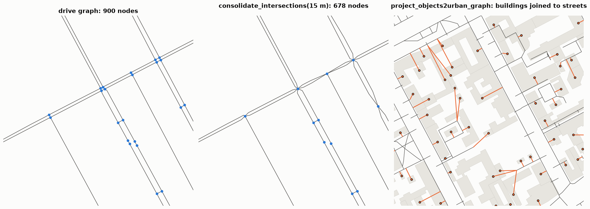

Graph operations
================

.. currentmodule:: iduedu

Overview
--------

The editing functions inspect, cut, join and transform :class:`UrbanGraph` objects, and attach objects such as
buildings or stops to them. They return new graphs and leave the source unchanged; the matching
:class:`UrbanGraph` methods change the graph itself with ``inplace=True``.

.. list-table::
   :header-rows: 1
   :widths: 28 72

   * - Task
     - Functions
   * - Connectivity
     - :func:`connected_components`, :func:`strongly_connected_components`, :func:`keep_largest_connected_component`
   * - Cutting and joining
     - :func:`subgraph_by_nodes`, :func:`clip_urban_graph`, :func:`join_urban_graphs`, :func:`relabel_urban_graph`
   * - Topology
     - :func:`to_directed`, :func:`to_undirected`, :func:`simplify_multiedges`, :func:`consolidate_intersections`,
       :func:`unique_segments`
   * - Objects
     - :func:`nearest_nodes`, :func:`nearest_edges`, :func:`project_objects2urban_graph`,
       :func:`apply_urban_graph_changes`
   * - Storage and checks
     - :func:`read_urban_graph`, :func:`write_urban_graph`, :func:`validate_graph`

Connectivity
------------

A route exists only inside one connected component. :func:`connected_components` finds the components of an
undirected graph; on a directed graph, :func:`weakly_connected_components` ignores the direction and
:func:`strongly_connected_components` keeps it, so every node of a strong component reaches every other. The
``number_*`` functions count the components and the ``largest_*`` functions return the node ids of the largest
one. :func:`keep_largest_connected_component` returns the graph cut to it, strong components on directed graphs.
The builders do the same with ``keep_largest_subgraph=True``. Components are computed in the Rust core.

Cutting and joining
-------------------

:func:`subgraph_by_nodes` keeps the given nodes and the edges between them. :func:`clip_urban_graph` keeps the part
of a graph inside a polygon; a bare shapely polygon is read in EPSG:4326, as ``territory`` in the graph builders,
and a GeoSeries or GeoDataFrame in its own CRS. :func:`join_urban_graphs` concatenates the tables of compatible
graphs, and :func:`relabel_urban_graph` renumbers the nodes ``0 .. n-1``.

Topology
--------

:func:`to_directed` returns a directed graph whose direction comes from a boolean column, ``oneway`` by default;
edges without a value get ``default_direction_value`` (``False``: both directions). :func:`to_undirected` drops the
direction. :func:`simplify_multiedges` keeps one of the parallel edges between two nodes, the cheapest by
``weight`` with ``rule="min"`` (the default).

:func:`consolidate_intersections` merges the nodes OSM draws for one junction, for example where two dual
carriageways cross. Nodes closer than ``tolerance`` form clusters (single linkage), and a cluster is split into the
parts that edges inside it connect, so a bridge above a road stays apart. Each part becomes one node at the mean
position of its members, and the edges keep their geometry with moved end points. Parts wider than ``max_span``
(four times the tolerance by default) stay unmerged. The function serves network statistics and centralities;
it changes routing, because turns and one-way links inside a junction disappear.

:func:`unique_segments` returns the straight pieces of the edge geometries with every physical segment once, also
where two edges of a two-way street or a there-and-back pair share their points. Its total length is the network
length on the ground, which :func:`graph_stats` uses.

Objects
-------

:func:`nearest_nodes` returns the nearest graph node of every object, and :func:`nearest_edges` the nearest edge
with the distance to it and the position along it. Objects are matched by their representative point, a point
inside the geometry. Routing and analysis functions take objects with a ``graph_node_id`` column as they are and
match the others to their nearest nodes themselves.

:func:`project_objects2urban_graph` inserts objects into the graph. The nearest edge of every object within
``max_dist`` is split at the projection point, and with ``add_link_edge=True`` (the default) a new node for the
object and a link edge at ``speed_m_per_min`` join it to that point. The function returns the changes,
an :class:`UrbanGraphChanges` with the nodes and edges to add and the edges to delete, and the node of every
object. :func:`apply_urban_graph_changes` applies them; :meth:`UrbanGraph.project_objects` does both in one call.
Keeping the changes apart lets a service store them in its own tables.

.. code-block:: python

   graph, home_nodes = walk.project_objects(homes, 5 * 1000 / 60, max_dist=200)
   homes["graph_node_id"] = home_nodes               # used by od_matrix, aggregate_objects, ...

Storage and checks
------------------

:func:`write_urban_graph` and :func:`read_urban_graph` store and read ``.urbangraph`` archives, and
:func:`validate_graph` checks the tables after your own edits (see :doc:`urban_graph`).

Functions
---------

.. autosummary::
    :toctree: ../api/generated
    :nosignatures:

    connected_components
    weakly_connected_components
    strongly_connected_components
    number_connected_components
    number_weakly_connected_components
    number_strongly_connected_components
    largest_connected_component
    largest_weakly_connected_component
    largest_strongly_connected_component
    largest_component
    keep_largest_connected_component
    subgraph_by_nodes
    clip_urban_graph
    join_urban_graphs
    relabel_urban_graph
    to_directed
    to_undirected
    simplify_multiedges
    consolidate_intersections
    unique_segments
    nearest_nodes
    nearest_edges
    project_objects2urban_graph
    apply_urban_graph_changes
    UrbanGraphChanges
    read_urban_graph
    write_urban_graph
    validate_graph

NetworkX is not installed with IduEdu. Install it separately (``pip install networkx``) to use the helpers below;
without it they raise ``ImportError`` when called.

.. autosummary::
    :toctree: ../api/generated
    :nosignatures:

    urban_graph2nx_graph
    nx_graph2urban_graph
    graph2gdf
    gdf2graph
    keep_largest_nx_component
    clip_nx_graph
    read_gml
    write_gml
    reproject_graph

Figures
-------

   Vasilyevsky Island. Left and middle: junctions of the drive graph before and after
   ``consolidate_intersections(drive, 15)``, which reduces the district from 900 to 678 nodes; carriageways more
   than 15 m apart stay separate. Right: buildings joined to the nearest walkable edge by
   :meth:`UrbanGraph.project_objects`; orange lines are the new link edges.

Limitations
-----------

- :func:`consolidate_intersections` works with distances only and can join nodes that are close but belong to
  different junctions; check the result on a map and set ``tolerance`` to the width of the junctions.
- :func:`project_objects2urban_graph` attaches every object to one edge; an object far from any edge (beyond
  ``max_dist``) stays unattached.

Example notebook
----------------

:doc:`../examples/graph_operations`, :doc:`../examples/connectivity`, :doc:`../examples/objects_and_nearest_nodes`
