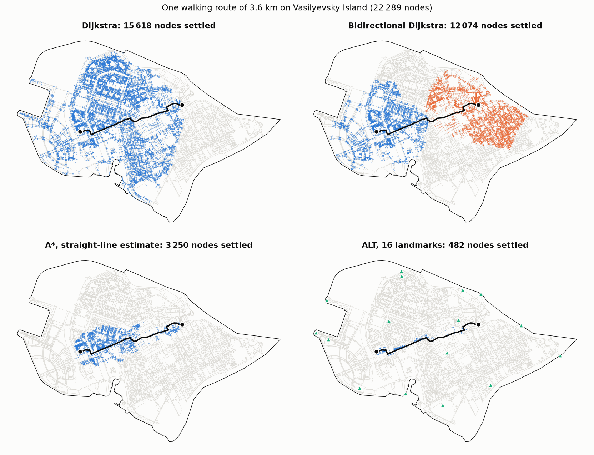
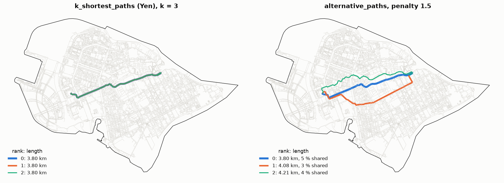

Routes between two points
=========================

.. currentmodule:: iduedu

Overview
--------

A route between two nodes does not need the costs to the whole network. :func:`shortest_path` finds one shortest
route with one of four searches that differ in how many nodes they visit before they reach the target, and
:func:`od_matrix` with ``mode="pairwise"`` runs the same searches for many pairs. :func:`alternative_paths` returns
several routes along different streets, and :func:`k_shortest_paths` the k cheapest routes without loops.

.. code-block:: python

   cost, route = graph.shortest_path(source, target, weight="time_min")      # bidirectional search
   cost, route = graph.shortest_path(source, target, method="alt")           # A* with landmarks
   routes = graph.alternative_paths(source, target, 3, weight="length_meter")
   ranked = graph.k_shortest_paths(source, target, 3, weight="length_meter")

:func:`shortest_path` returns ``(cost, route)``: the cost in the units of ``weight`` and the list of node ids from
the source to the target, or ``(inf, [])`` when the target is not reached within ``cutoff``.

Search methods
--------------

Every method returns a shortest route; they differ in speed only. The cost of the returned route is summed again
from the source along the route, so it equals the float32 sum of a Dijkstra search along the same route. When
several routes have the same cost, different methods can return different ones.

``"dijkstra"``
   One search from the source that settles nodes in order of their cost and stops at the target. It visits every
   node that is cheaper to reach than the target, in all directions.

``"bidirectional"`` (default)
   A search from the source over the graph and a search from the target over the reversed graph run at the same
   time; each step settles a node on the side whose next cost is smaller. Every edge scanned from a settled node
   that reaches a node already seen by the other side gives a candidate route. The search stops once the next costs
   of the two sides add up to at least the cost of the best candidate (bidirectional search, Pohl, 1971). Each side
   covers about half of the route cost, so on the walk graph of Saint Petersburg a query runs 1.2 to 3.4 times
   faster than one search from the source, the more so the closer the target. The method needs nothing beyond the
   graph and works with any weight.

``"astar"``
   A search from the source that settles nodes in order of their cost plus an estimate of the cost that remains to
   the target (A*, Hart, Nilsson and Raphael, 1968). The estimate is the straight distance to the target times the
   smallest cost per metre of straight distance over the edges of the graph. No edge is cheaper than that rate, so
   by the triangle inequality the estimate never exceeds the cost of a route, and the result is exact for any
   weight. The method needs a point geometry for every node. An edge of zero cost between two distinct points
   would set the rate to zero; such edges (in OSM walk graphs, a few edges of 1–4 cm whose rounded travel time is
   zero) are left out of the rate, and the search goes on until no queued node can improve the result by more than
   the estimate can exceed the cost through them. The estimate prunes the search where costs follow distance:
   walking and driving by ``length_meter``, walking by ``time_min``. On an intermodal graph the fastest edges
   (subway) set the rate, and the search takes as long as Dijkstra.

``"alt"``
   A* with an estimate taken from the network itself (ALT: A*, landmarks and the triangle inequality; Goldberg and
   Harrelson, 2005). Sixteen nodes are chosen as landmarks, each the node farthest from the landmarks chosen before,
   which places them at the edges of the graph. For every landmark ``L`` the costs from ``L`` to every node and from
   every node to ``L`` are computed once. The triangle inequality bounds the remaining cost from ``v`` to the target
   ``t`` from below by ``d(L, t) - d(L, v)`` and by ``d(v, L) - d(t, L)``; the estimate is the largest of these
   bounds over the landmarks. It follows the costs of the network, subway included, so it stays sharp on
   intermodal graphs and needs no coordinates. The tables are built on the first call and kept with the graph
   until its nodes, edges or weight change. They take 4 bytes per node and landmark, twice as much on a directed
   graph, which needs the costs in both directions (33 MB and 0.7 s for the undirected walk graph of Saint
   Petersburg, 518 thousand nodes). The method pays off when one graph answers many queries.

   Nodes settled by the four methods for one walking route of 3.6 km by ``length_meter`` on Vasilyevsky Island
   (22 thousand nodes). The bidirectional search settles nodes from the source (blue) and from the target
   (orange); green triangles are the landmarks of ALT. All four return a route of the same length (black).

Choosing a method
~~~~~~~~~~~~~~~~~

The table gives the time of one query in milliseconds on one thread, measured on graphs of Saint Petersburg
(500 pairs per row; random pairs lie anywhere in the city, the other rows hold pairs at the given straight
distance).

.. list-table::
   :header-rows: 1
   :widths: 40 15 15 15 15

   * - Graph, weight, pairs
     - Dijkstra
     - bidirectional
     - A*
     - ALT
   * - walk (518 thousand nodes), length, 4 km
     - 2.6
     - 1.1
     - 0.56
     - 0.28
   * - walk, time, 10 km
     - 11.7
     - 4.8
     - 3.7
     - 0.83
   * - walk, time, random pairs
     - 18.0
     - 14.4
     - 10.9
     - 1.9
   * - drive (32 thousand nodes), time, random pairs
     - 0.77
     - 0.51
     - 0.54
     - 0.10
   * - intermodal (533 thousand nodes), time, 10 km
     - 21.3
     - 4.5
     - 23.7
     - 5.1

The bidirectional search is the default: it needs no preparation, works on any graph and weight, and is faster than
Dijkstra on every graph of the table. On random pairs across a city it gains less, because a search from one end of
the city is already cut off by the city border. ALT is the fastest on the street graphs once its tables exist; on
the intermodal graph it is as fast as the bidirectional search on pairs 10 km apart and 1.4 times faster on random
pairs. A* is worth its coordinates on walk and drive graphs measured by length.

Pairwise tables
~~~~~~~~~~~~~~~

:func:`od_matrix` and :func:`iter_od_matrix` with ``mode="pairwise"`` take a ``method`` argument. ``"dijkstra"`` runs
one search per unique origin that stops once all destinations paired with it are settled, which suits origins
with many destinations. ``"bidirectional"``, ``"astar"`` and ``"alt"`` run one point-to-point search per pair. The
default ``"auto"`` chooses ``"bidirectional"`` when most origins occur once and ``"dijkstra"`` when they repeat.
All-to-all tables always run one Dijkstra search per source (see :doc:`shortest_paths`).
:func:`single_source_dijkstra_path` runs the bidirectional search too.

Alternative routes
------------------

:func:`alternative_paths` finds routes that differ by whole streets, with the penalty method:

1. The shortest route is found and kept.
2. The costs of the edges of the route are multiplied by ``penalty`` (1.5 by default), in both directions of each
   street, and the search runs again on the new costs. The next route leaves the streets already taken wherever a
   detour exists and keeps them where it does not, for example on a bridge.
3. A route is kept when its real cost is at most ``max_cost_ratio`` times the cost of the shortest route (1.4 by
   default) and at most ``max_overlap`` of its real cost (0.7 by default) runs on the streets of a route kept
   before. Every route found is penalised, kept or not.
4. The search stops after ``k`` routes or ``4 * k`` searches.

The result is a table indexed by ``rank`` (0 is the shortest route, then by cost) with the columns ``dist`` (real
cost in the units of ``weight``), ``overlap`` (the largest share of that cost on the streets of another route of
the table) and ``path`` (node ids). A street here is an edge of the graph: on a walk graph the sidewalk on the
other side of an avenue is another street, so a route along it counts as different.

k shortest routes
-----------------

:func:`k_shortest_paths` returns the k cheapest loopless routes in order of cost (Yen, 1971). Every next route leaves
an earlier one at some node, the spur node: it follows the earlier route up to there and then takes the shortest
way to the target that touches no node of the shared part and does not continue the way a route found before
continues from the same part. The candidates are kept in a heap, and the cheapest one not yet taken becomes the
next route. Spur nodes are taken from the node where a route left its parent onwards (Lawler, 1972), and the spur
searches of one route run in parallel, each a bidirectional search. The result has the columns ``dist`` and
``path`` under the ``rank`` index.

These are the next cheapest routes exactly. In a sparse network, such as a railway network or intercity roads,
they run along different lines. In a dense street graph the next cheapest route is the same route with a small
change: crossing at the next pedestrian crossing, taking the other sidewalk. For a walk of 4.9 km in Saint
Petersburg the three cheapest routes differ by 1.7 m, while :func:`alternative_paths` returns routes of 4.9, 5.3
and 5.5 km with 0 to 12 % of shared streets. On the same graph a query takes 2 to 8 ms with
:func:`alternative_paths`, and 0.57 s with :func:`k_shortest_paths` for ``k=3`` on a route of 536 nodes, which
needs a spur search from almost every node of the route.

   One walk on Vasilyevsky Island measured by ``length_meter``. Left: the three cheapest routes of
   :func:`k_shortest_paths` lie on top of each other. Right: :func:`alternative_paths` with the default limits;
   the percentages are the column ``overlap``.

Functions
---------

.. autosummary::
    :toctree: ../api/generated
    :nosignatures:

    shortest_path
    alternative_paths
    k_shortest_paths

Limitations
-----------

- :func:`alternative_paths` and :func:`k_shortest_paths` answer one pair per call.
- The landmark tables of ALT belong to one weight of one graph; they are built again after the graph changes and
  take memory proportional to the number of nodes.
- A* needs a point geometry for every node; on graphs without coordinates use ``"bidirectional"`` or ``"alt"``.
- Costs are float32 sums; routes of equal cost can differ between methods, and their costs agree up to float32
  rounding.

References
----------

- Goldberg, A. V. and Harrelson, C. (2005). Computing the shortest path: A* search meets graph theory. *Proceedings
  of the Sixteenth Annual ACM-SIAM Symposium on Discrete Algorithms*, 156–165.
- Hart, P. E., Nilsson, N. J. and Raphael, B. (1968). A formal basis for the heuristic determination of minimum cost
  paths. *IEEE Transactions on Systems Science and Cybernetics*, 4(2), 100–107.
- Lawler, E. L. (1972). A procedure for computing the K best solutions to discrete optimization problems and its
  application to the shortest path problem. *Management Science*, 18(7), 401–405.
- Pohl, I. (1971). Bi-directional search. In B. Meltzer and D. Michie (Eds.), *Machine Intelligence 6*, 127–140.
  Edinburgh University Press.
- Yen, J. Y. (1971). Finding the K shortest loopless paths in a network. *Management Science*, 17(11), 712–716.

Example notebook
----------------

:doc:`../examples/routing_methods`
