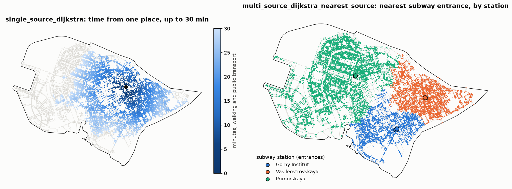

Shortest paths and matrices
===========================

.. currentmodule:: iduedu

Overview
--------

The routing functions compute the cost of the shortest path, the path itself or both, from one source, from a set
of sources or between sets of origins and destinations. The cost is the sum of an edge column: ``time_min``
(travel time in minutes, the default) or ``length_meter`` (network distance in metres). Every function takes an
:class:`UrbanGraph` and returns pandas tables labelled by node ids or by the labels of the input objects.

.. list-table::
   :header-rows: 1
   :widths: 34 66

   * - Function
     - Result
   * - :func:`single_source_dijkstra`
     - Costs and paths from one node to every reachable node, or to the requested targets
   * - :func:`multi_source_dijkstra`
     - The same from a set of sources taken as one: every node gets the cost from its nearest source
   * - :func:`multi_source_dijkstra_nearest_source`
     - The nearest source of every node and the cost from it
   * - :func:`dijkstra_parallel`
     - One independent row per source
   * - :func:`od_matrix`
     - Costs or paths between origins and destinations: all pairs, or the pairs matched by position
   * - :func:`iter_od_matrix`
     - :func:`od_matrix` in blocks of origin rows, for matrices that do not fit in memory at once
   * - :func:`path_to_edges`
     - The edges of a node path, in order and with their geometry

One path between two nodes, alternative routes and the k shortest routes are described in
:doc:`point_to_point`.

Inputs
------

Sources, origins and destinations are node ids (``source_node``, ``source_nodes``, ``origins_nodes``,
``destination_nodes``) or tables of objects (``gdf_sources``, ``gdf_origins``, ``gdf_destinations``). A table with
a ``graph_node_id`` column (the name is set by ``graph_node_column``) is used as is; otherwise every geometry is
matched to its nearest graph node with :func:`nearest_nodes`. Objects matched to the same node share one search, and
the results keep the labels and the order of the input rows, duplicates included. To measure from the exact
position of an object on an edge, insert it into the graph first with :func:`project_objects2urban_graph`
(see :doc:`../graph/operations`).

``cutoff`` limits the cost of a path (inclusive, in the units of ``weight``); nodes beyond it are not reached.
``threshold`` is an alias of ``cutoff`` on the matrix functions. ``reverse=True`` searches against the edge
directions of a directed graph: the costs are then those of the paths from every node *to* the source.

Method
------

1. The graph is turned into a compressed sparse row (CSR) adjacency matrix of the selected weight. Parallel edges
   between two nodes, in either orientation of an undirected graph, are merged into one arc with the smallest
   cost. The matrix and its Rust copy are cached on the graph and reused for the same weight until the edge
   weights, directions or ends change (see :doc:`../graph/urban_graph`).
2. Every unique source runs one Dijkstra search in the Rust extension, ``iduedu._rust``. The searches of
   different sources run in parallel threads (``max_workers``, one per CPU by default) and stop once every
   requested target is settled or the next node lies beyond ``cutoff``.
3. An all-to-all matrix with fewer unique destinations than origins is computed from the destinations on the
   reversed graph, and the result is transposed back. A pairwise matrix (``mode="pairwise"``) searches only the
   pairs it needs; when most origins occur once, it runs one point-to-point search per pair (see
   :doc:`point_to_point`).
4. Costs are summed in float32. ``dtype`` sets the type of the returned table only.

Outputs
-------

``output`` selects what a function returns:

- ``"distances"``: a sparse table of costs. Unreachable pairs and pairs beyond ``cutoff`` hold ``inf``; a node
  reached from itself costs ``0``, and so do paths over zero-cost edges.
- ``"paths"``: a sparse table of node paths. Each cell is a list of node ids from the source to the target, or
  ``None`` when the target is not reached.
- ``"both"``: a :class:`ShortestPathResult` with ``distances`` and ``paths`` from the same searches.

:func:`od_matrix` returns a table with the origins as rows and the destinations as columns. In pairwise mode the
table has a ``(origin, destination)`` index and one column, ``dist`` or ``path``. Single-source and multi-source
results are Series indexed by node id; with ``target_nodes=None`` they contain the reachable nodes only. The tables
keep the node of every input object in ``attrs`` (``origin_nodes``, ``destination_nodes`` or ``source_nodes``).
:func:`multi_source_dijkstra_nearest_source` returns the columns ``source_node`` (graph node id of the nearest
source) and ``dist``; equal costs go to the source that comes first in the graph's node order.

:func:`path_to_edges` turns a node path into the GeoDataFrame of its edges with the columns ``path_order``,
``path_u`` and ``path_v``. Between parallel edges it takes the cheapest one by ``weight``, as the search does, and
reverses the geometry of an edge travelled against its direction.

.. code-block:: python

   result = graph.od_matrix(
       gdf_origins=buildings,
       gdf_destinations=schools,
       weight="time_min",
       cutoff=30,
       output="both",
   )
   result.distances                          # minutes, inf beyond 30
   path = result.get_path(buildings.index[0], schools.index[0])
   edges = graph.path_to_edges(path)         # geometry of the route

Paths on demand
---------------

With ``output="both"`` and ``path_storage="lazy"`` the result keeps the search trees (the parent of every settled
node) and builds a path only when it is asked for: ``result.get_path(origin, destination)`` for one path,
``result.paths`` for the whole table. Labels repeated in the input are reached by position with
``result.get_path_at(row, column)``. The trees are copies, so a later change of the graph does not change saved
paths. A tree holds every node its search settled, so lazy storage saves memory when many paths share their
trees and only some of them are read.

Large matrices
--------------

``batch_size`` limits the number of searches that run at the same time; the returned table and the kept trees still
hold every row. :func:`iter_od_matrix` takes the same arguments as :func:`od_matrix` and yields the result in blocks
of ``batch_size`` origin rows, so that each block can be written out and released:

.. code-block:: python

   import pandas as pd

   nearest = []
   for block in graph.iter_od_matrix(
       gdf_origins=buildings, gdf_destinations=schools, cutoff=30, batch_size=2048
   ):
       nearest.append(block.sparse.to_dense().min(axis=1))  # minutes to the nearest school
   nearest = pd.concat(nearest)

Objects are matched to nodes once for all blocks. The graph must not change while the blocks are read. Each block
keeps its node mapping in ``attrs``, and pandas compares ``attrs`` when it concatenates tables: clear them
(``block.attrs = {}``) before concatenating the blocks themselves.

Functions
---------

.. autosummary::
    :toctree: ../api/generated
    :nosignatures:

    single_source_dijkstra
    multi_source_dijkstra
    multi_source_dijkstra_nearest_source
    dijkstra_parallel
    od_matrix
    iter_od_matrix
    ShortestPathResult
    single_source_dijkstra_path
    path_to_edges

Figures
-------

   Intermodal graph of Vasilyevsky Island (walking and public transport). Left: :func:`single_source_dijkstra`
   from one place with ``cutoff=30`` minutes; every street node is coloured by its travel time. Right:
   :func:`multi_source_dijkstra_nearest_source` from the entrances of the three subway stations; every street node
   takes the colour of the station whose entrance it reaches first.

Limitations
-----------

- Costs are those stored on the edges: travel times do not depend on the time of day, turns cost nothing and
  public-transport waits are averages (see :doc:`../building/public_transport` and :doc:`../building/gtfs`).
- Objects matched to their nearest node are placed at that node; the distance from the object to the node is not
  added. Project the objects onto the edges when it matters.
- Equal-cost paths are resolved by the order of the search, so two runs of different functions can return
  different paths of the same cost.

Example notebook
----------------

:doc:`../examples/shortest_paths`
